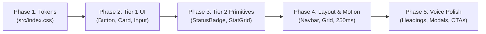

# CSEC-ASTU BMS — UI/UX Improvement Plan (Livery-Adapted)

**Document Version:** 1.0.0  
**Target Workspace:** `csec-astu-bms-project/frontend`  
**Foundation:** Adapted from the Udemy Design System Kit (`livery-udemy-com-v1`), tailored specifically to retain CSEC-ASTU brand identity while upgrading tokens, components, rhythm, motion, details, and voice.

---

## 1. Executive Summary & Design Vision

The CSEC-ASTU Bootcamp Management System (BMS) manages complex academic operations across five distinct user roles (`SUPER_ADMIN`, `DIVISION_ADMIN`, `INSTRUCTOR`, `STUDENT`, `GUEST`). 

This improvement plan applies the structural elegance, craft details, neutral depth, and conversational directness of the **Udemy design kit (Livery v1)** while preserving **CSEC-ASTU's core brand identity** (Electric Blue `#2563eb` / `#3b82f6`).

```text
┌────────────────────────────────────────────────────────────────────────┐
│                        CSEC-ASTU BRAND IDENTITY                         │
│           Primary Brand Accent: Electric Blue (#2563eb / #3b82f6)      │
│           Preserved: CSEC-ASTU Logo, Club Name, Official Branding      │
└────────────────────────────────────┬───────────────────────────────────┘
                                     │ Adapted Into
┌────────────────────────────────────▼───────────────────────────────────┐
│                       LIVERY-DERIVED FOUNDATION                         │
│  • Neutral dark surfaces (#090d16 / #202230) & 1px borders (#3d4055)   │
│  • Neutral soft shadows: oklch(0.6295 0.0204 306.5 / 0.08) (untinted)  │
│  • Standardized 8px corner radii (4px pills, 24px major blocks)        │
│  • Strict 4px spacing grid (4, 8, 12, 16, 24, 32px)                    │
│  • 1340px centered container & 72px clean navbar                       │
│  • 250ms quiet transitions, signature float, & balanced typography     │
│  • Direct, conversational voice (concise, active "you", sentence-case) │
└────────────────────────────────────────────────────────────────────────┘
```

---

## 2. Brand Identity Preservation vs. Livery Upgrades

| Design System Dimension | Udemy Livery v1 Spec | CSEC-ASTU Brand Adaptation | Rationale |
| :--- | :--- | :--- | :--- |
| **Primary Accent** | Dark Violet `#6d28d2` | **CSEC Electric Blue (`#2563eb` / `#3b82f6`)** | User requirement: Preserve club brand color. |
| **Accent Foreground** | White `#ffffff` | **White `#ffffff`** | 4.5:1+ WCAG AA contrast against blue accent. |
| **Dark Theme Background** | Near-black `#00000000` | **Rich Black/Navy `#090d16`** | Cohesive with existing dark aesthetic. |
| **Card & Surface Background** | Neutral Dark `#202230` | **Neutral Dark `#131b2e` / `#202230`** | Deep neutral base that highlights active cards. |
| **Borders** | 1px in `#3d4055` | **1px in `#232d42` (Dark) / `#e2e8f0` (Light)** | Crisp separation without harsh visual weight. |
| **Elevation / Shadows** | Soft neutral `oklch(...)` | **Neutral Untinted Shadows (Never blue-tinted)** | Adheres to Livery rule: *Never tint shadows*. |
| **Corner Radii** | 8px default (52% usage) | **8px default, 4px badges, 24px cards** | Unifies controls across the two-tier UI. |
| **Typography Scale** | Anchored on 16px body, 32px h1 | **Geist Variable (Scale: 14, 16, 18, 20, 24, 28, 32px)** | Clean, geometric monospace/sans legibility. |
| **Voice & Tone** | Direct, concise, ~10 words | **Direct, student-centric, sentence-case** | Removes bureaucratic university phrasing. |

---

## 3. Level 1: Design Tokens (`src/index.css`)

Update the centralized Tailwind CSS v4 variables in `src/index.css` to implement the neutral palette, standardized radii, and un-tinted elevation.

```css
@import "tailwindcss";
@import "@fontsource-variable/geist";

@layer base {
  :root {
    /* ── Light Mode Base ───────────────────────── */
    --background: #f8fafc;
    --foreground: #0f172a;
    --surface: #ffffff;
    --surface-alt: #f1f5f9;
    --border: #e2e8f0;
    --border-subtle: #f1f5f9;

    /* ── CSEC-ASTU Brand Colors ─────────────────── */
    --primary: #2563eb;
    --primary-hover: #1d4ed8;
    --primary-foreground: #ffffff;
    --accent: #eff6ff;
    --accent-foreground: #1d4ed8;

    /* ── Neutrals & Text ────────────────────────── */
    --text-main: #0f172a;
    --text-muted: #64748b;
    --text-subtle: #94a3b8;

    /* ── Semantics (Badges & Alerts) ───────────── */
    --success: #10b981;
    --warning: #f59e0b;
    --destructive: #ef4444;

    /* ── Radii & Depth (Livery 8px Standard) ───── */
    --radius-sm: 4px;
    --radius-md: 8px;     /* Default for buttons, inputs, dropdowns */
    --radius-lg: 16px;
    --radius-xl: 24px;    /* Major dashboard surface cards */

    /* ── Untinted Soft Neutral Shadows ──────────── */
    --shadow-soft: 0 2px 8px 0 rgba(15, 23, 42, 0.06);
    --shadow-card: 0 4px 16px 0 rgba(15, 23, 42, 0.08);
    --shadow-floating: 0 12px 32px 0 rgba(15, 23, 42, 0.12);
  }

  .dark {
    /* ── Dark Mode Base (Livery Dark Neutral) ───── */
    --background: #090d16;
    --foreground: #f8fafc;
    --surface: #121826;
    --surface-alt: #1a2234;
    --border: #232d42;
    --border-subtle: #192132;

    /* ── CSEC-ASTU Brand Colors (Dark Mode) ─────── */
    --primary: #3b82f6;
    --primary-hover: #60a5fa;
    --primary-foreground: #ffffff;
    --accent: #1e293b;
    --accent-foreground: #93c5fd;

    /* ── Neutrals & Text ────────────────────────── */
    --text-main: #f8fafc;
    --text-muted: #94a3b8;
    --text-subtle: #64748b;

    /* ── Untinted Soft Neutral Shadows ──────────── */
    --shadow-soft: 0 2px 8px 0 rgba(0, 0, 0, 0.4);
    --shadow-card: 0 4px 16px 0 rgba(0, 0, 0, 0.5);
    --shadow-floating: 0 12px 32px 0 rgba(0, 0, 0, 0.65);
  }

  /* ── Core Global Polish ──────────────────────── */
  * {
    border-color: var(--border);
  }

  body {
    background-color: var(--background);
    color: var(--foreground);
    font-family: 'Geist Variable', -apple-system, BlinkMacSystemFont, "Segoe UI", Roboto, sans-serif;
    font-feature-settings: "cv02", "cv03", "cv04", "cv11";
    text-rendering: optimizeLegibility;
    -webkit-font-smoothing: antialiased;
  }

  /* Balanced Text Wrapping */
  h1, h2, h3, h4, h5, h6 {
    text-wrap: balance;
  }
  p {
    text-wrap: pretty;
  }

  /* Restyled Livery Dark Scrollbars */
  ::-webkit-scrollbar {
    width: 8px;
    height: 8px;
  }
  ::-webkit-scrollbar-track {
    background: var(--background);
  }
  ::-webkit-scrollbar-thumb {
    background: var(--border);
    border-radius: 4px;
  }
  ::-webkit-scrollbar-thumb:hover {
    background: var(--text-subtle);
  }
}
```

---

## 4. Level 2: Component Architecture & Recipes

Per **ADR-0013**, the two-tier component seam is strictly maintained. Upgrades are made inside primitives so all pages update automatically.

### 4.1 Tier 1 Base UI Primitives (`src/components/ui/*`)

#### 1. Button (`src/components/ui/button.tsx`)

- **Corners:** Standardized to `8px` (`rounded-[8px]`).
- **Variants:**
  - `primary`: Background `var(--primary)`, text white, 250ms transition. Hover: `var(--primary-hover)`.
  - `outline`: Transparent background, border `1px solid var(--primary)`, text `var(--primary)`. Hover: background `var(--accent)`.
  - `ghost`: Transparent background, text `var(--text-muted)`. Hover: text `var(--primary)`, background `var(--surface-alt)`.
  - `destructive`: Background `var(--destructive)`, text white.
- **Rules:** Never use all-caps text on buttons. Always short nouns or action verbs (2 words).

#### 2. Card (`src/components/ui/card.tsx`)

- **Background:** `var(--surface)` (clean dark `#121826` in dark mode).
- **Border:** `1px solid var(--border)`.
- **Radius:** `rounded-[16px]` or `rounded-[8px]`.
- **Elevation:** Neutral shadow `var(--shadow-soft)`. Hover state: transition `var(--shadow-card)` and subtle border highlight (250ms ease).

#### 3. Form Field & Input (`src/components/ui/input.tsx`)

- **Radius:** `rounded-[8px]`.
- **Border:** `1px solid var(--border)`.
- **Focus State:** 2px solid `:focus-visible` ring using `var(--primary)` without fuzzy multi-color glows.

---

### 4.2 Tier 2 Deep Domain Primitives (`src/components/common/*`)

#### 1. StatusBadge (`src/components/common/StatusBadge.tsx`)

- Encapsulates 18 domain statuses (`PRESENT`, `LATE`, `ACTIVE`, `INDUCTED`, etc.).
- **Style:** Compact pill (`rounded-[4px]`), subtle background (10% opacity), crisp text with matching icon.
- **Example:**
  - `INDUCTED`: Deep emerald background tint + emerald text + ShieldCheck icon.
  - `ACTIVE`: Blue background tint + blue text + Activity icon.
  - `PENDING`: Amber background tint + amber text + Clock icon.

#### 2. StatGrid (`src/components/common/StatGrid.tsx`)

- Standardized KPI cards for dashboard metrics.
- Card padding: `24px` on desktop, `16px` on mobile.
- Typography: Label at `14px` weight 400 (`text-muted`), metric number at `28px` weight 600 (`text-main`).
- Subtle trend indicator (`+12% vs last cohort`).

#### 3. PageHeader (`src/components/common/PageHeader.tsx`)

- Title in sentence case (e.g. *"Bootcamp sessions"* rather than *"Bootcamp Sessions Overview"*).
- Direct subtitle under 14 words.
- Unified action slot (e.g. single primary action button *"Create session"*).

---

## 5. Level 3: Layout, Spacing & Container Rhythm

Adopting the measured rhythm from `layout.md`:

```text
┌────────────────────────────────────────────────────────────────────────┐
│ NAVBAR: 72px Fixed / Sticky Header                                     │
│ Logo | Active Role Switcher | Search | Notification Bell | User Avatar │
├──────────┬─────────────────────────────────────────────────────────────┤
│ SIDEBAR  │ MAIN CONTENT CONTAINER (Max-width: 1340px Centered)         │
│          │                                                             │
│ 256px    │ ┌─────────────────────────────────────────────────────────┐ │
│ / 60px   │ │ PageHeader (Sentence case, clean action button)          │ │
│          │ └─────────────────────────────────────────────────────────┘ │
│          │  ↕ 24px vertical gap                                        │
│          │ ┌─────────────────────────────────────────────────────────┐ │
│          │ │ StatGrid (3 or 4 columns, 16px gap, 24px inner padding)  │ │
│          │ └─────────────────────────────────────────────────────────┘ │
│          │  ↕ 32px section rhythm                                      │
│          │ ┌─────────────────────────────────────────────────────────┐ │
│          │ │ Main Data Cards / Tables (8px/16px radius, neutral depth)│ │
│          │ └─────────────────────────────────────────────────────────┘ │
└──────────┴─────────────────────────────────────────────────────────────┘
```

### Strict Spacing Scale (4px Grid):

- **4px (`gap-1` / `p-1`):** Micro-spacing between icon and badge label.
- **8px (`gap-2` / `p-2`):** Button inner padding (vertical), tag margins.
- **12px (`gap-3` / `p-3`):** Nav link horizontal padding, input padding.
- **16px (`gap-4` / `p-4`):** Card inner padding on mobile, standard grid gap.
- **24px (`gap-6` / `p-6`):** Desktop card padding, section gap between related blocks.
- **32px (`gap-8` / `p-8`):** Major section separator spacing.

---

## 6. Level 4: Motion, Micro-Interactions & Craft Details

### 6.1 Transition Rules (`motion.md`)

- **Default Transition Duration:** Exactly **250ms** (`transition-all duration-250 ease`).
- **Maximum Duration:** Never exceed 300ms. Slower animations feel heavy and sluggish in productivity tools.
- **Animated Properties:** `background-color`, `border-color`, `color`, `opacity`, `transform`, `box-shadow`.
- **Layout shifts:** Never animate layout width or height; translate or fade elements instead.
- **Reduced Motion:** Always respect `@media (prefers-reduced-motion: reduce)` by disabling transitions.

### 6.2 Signature Float Animation

For prominent focal elements—such as the **Active Session Live PIN Banner** or the **Student Induction Decision Badge**—apply the signature gentle float animation:

```css
@keyframes bms-float {
  0% { transform: translateY(0px); }
  50% { transform: translateY(-3px); }
  100% { transform: translateY(0px); }
}

.animate-bms-float {
  animation: bms-float 2400ms ease-in-out infinite;
}
```

---

## 7. Level 5: Voice, Tone & Microcopy Standards

The LMS copy will be shifted from formal university terminology to direct, conversational, and active instructions per `voice.md`.

### Core Writing Principles:

1. **Sentence Case Everywhere:** Write *"Create session"*, not *"Create Session"*.
2. **Sentences Around 10 Words:** Avoid run-on academic clauses.
3. **Address the Reader as "You":** Active and empowering.
4. **Zero Exclamation Marks:** Maintain a calm, professional tone.
5. **Two-Word Buttons:** *"Save changes"*, *"Check in"*, *"Grade task"*, *"Submit link"*.

### Before & After Copy Matrix

| Context | Original Copy | Livery-Adapted Copy | Word Count |
| :--- | :--- | :--- | :--- |
| **PIN Check-In Modal** | *"Please enter your dynamic 6-digit attendance verification PIN during the active session window."* | **"Enter your 6-digit PIN before the session ends."** | 9 words |
| **Deliverable Submission** | *"Submit your completed repository URL or PDF document prior to the stated deadline for instructor evaluation."* | **"Turn in your GitHub link or file before the deadline."** | 10 words |
| **Induction Status Banner** | *"The 4-signal transparent evaluation model calculates student graduation induction status based on an aggregate index threshold of 75%."* | **"Score 75% or higher across all four areas to get inducted."** | 11 words |
| **Applicant Waiting State** | *"Your application has been received and is currently under administrative screening review by the division."* | **"We're reviewing your application. Check back soon."** | 7 words |
| **Empty Task State** | *"There are currently no assigned laboratory assignments or deliverables found for this cohort."* | **"No tasks yet. Enjoy the break."** | 6 words |
| **Instructor Grading CTA** | *"Evaluate and award point allocations for this student turn-in"* | **"Grade this submission."** | 3 words |
| **PIN Expiration Notice** | *"The attendance window for this session has officially expired and cannot accept further check-ins."* | **"The attendance window is closed."** | 5 words |

---

## 8. Implementation Roadmap

The improvements should be executed in 5 focused pull requests / commits:



1. **Phase 1: Design Tokens (`src/index.css`)**
   - Update CSS variables for neutral dark mode `#090d16` / `#202230`, `#3d4055` borders.
   - Retain `--primary: #2563eb / #3b82f6` for CSEC brand identity.
   - Configure 8px default radii and un-tinted neutral shadows.

2. **Phase 2: Tier 1 Base UI Primitives (`src/components/ui/*`)**
   - Refactor `button.tsx`, `card.tsx`, `input.tsx`, `modal.tsx`.
   - Implement ghost, outline, and primary button styling.

3. **Phase 3: Tier 2 Deep Domain Primitives (`src/components/common/*`)**
   - Refactor `StatusBadge.tsx` with 4px pill styling and desaturated tints.
   - Refactor `StatGrid.tsx` and `PageHeader.tsx` for clean rhythm and sentence-case.

4. **Phase 4: Layout & Rhythm (`src/components/layout/*`)**
   - Standardize navbar height to 72px, container max-width to 1340px.
   - Implement 250ms transitions and signature float on PIN modal and induction banner.

5. **Phase 5: Voice & Copy Polish**
   - Update labels, empty states, and modal descriptions across Student, Instructor, Admin, and Guest portals to direct ~10-word copy.

---

## 9. Verification & Quality Gates

Each phase must pass the following verification checks:

- [ ] **Typecheck:** `npm run lint` (`tsc --noEmit`) passes with exit code 0.
- [ ] **Unit Tests:** Frontend Vitest suite (`npm test`) passes 100% (13/13).
- [ ] **Production Build:** `npm run build` succeeds without bundle or chunk errors.
- [ ] **Contrast Verification:** Text contrast meets WCAG AA (4.5:1 for body, 3:1 for headers and UI borders).
- [ ] **ADR Conformance:** Tier 1 and Tier 2 architecture remains unviolated; page files remain lean.
